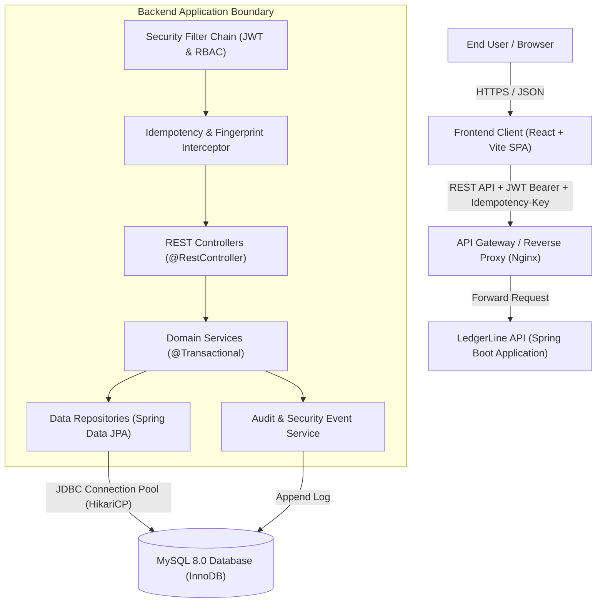
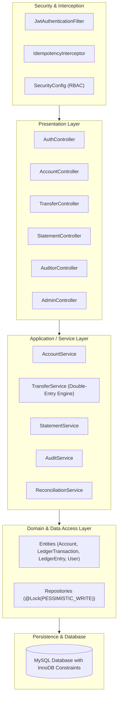
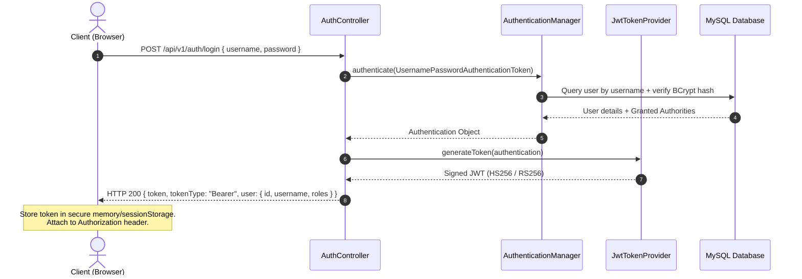
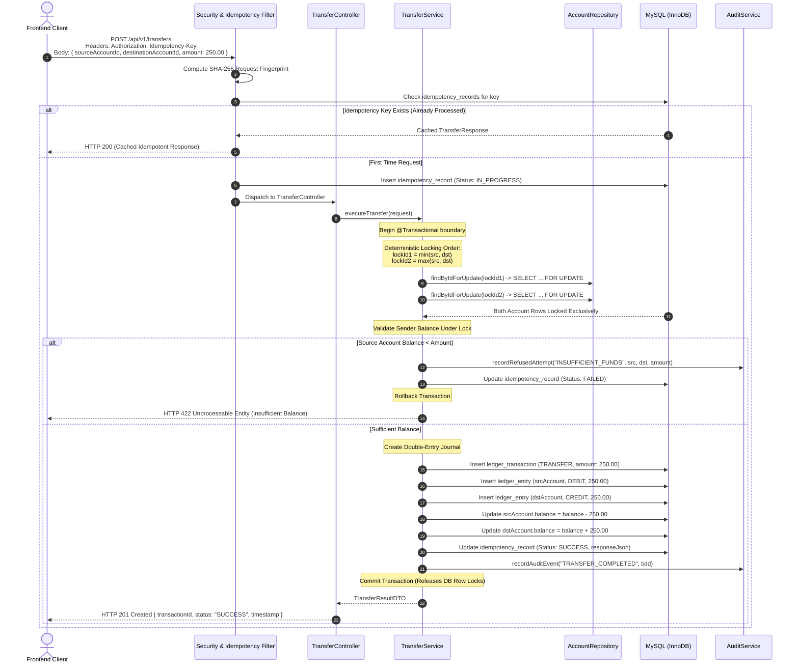
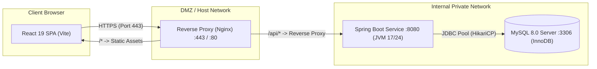

# LedgerLine — System Architecture Specification
**Date:** 2026-11-06
**Status:** Approved Architecture Baseline (Day 1)
**System:** LedgerLine — Money Movement With a Ledger You Can Prove

---

## 1. Architectural Vision & Principles

LedgerLine is built to provide provably immutable, high-integrity money movement. The core principle of LedgerLine is: **Balances are never arbitrated by loose increments; they are governed by double-entry ledger journals with strict atomicity, row-level locking, and continuous reconciliation.**

### Architectural Core Principles
1. **Conservation of Money:** Money is never created or destroyed arbitrarily. In every internal transaction, total debits must equal total credits.
2. **Append-Only Truth:** Ledger entries (`ledger_entries`) and ledger transactions (`ledger_transactions`) are strictly append-only. They are never updated or deleted through standard business APIs.
3. **Deterministic Concurrency:** To prevent deadlocks in bidirectional transfers (Account A -> B and B -> A concurrently), row lock acquisition must strictly follow natural ID sorting order (`min(id_from, id_to)` followed by `max(id_from, id_to)`).
4. **Defense in Depth:** Balance validity (`balance >= 0`) is enforced at three independent layers: DTO validation, service business logic under lock, and relational database check constraints.
5. **Idempotent Execution:** Every mutating financial request requires a client-supplied `Idempotency-Key` and a deterministic SHA-256 request fingerprint to eliminate duplicate execution risks from network retries.

---

## 2. High-Level System Architecture

LedgerLine adopts a modern decoupled client-server architecture consisting of:
- **Frontend SPA:** React 19, TypeScript, Vite, TailwindCSS.
- **Backend API:** Spring Boot (Java 17/24), Spring Data JPA, Spring Security, Flyway.
- **Persistence Store:** MySQL 8.0 relational database with ACID compliance, InnoDB engine, and row-level locking.



---

## 3. Backend Layered Architecture

The backend follows a strict clean-layer architecture where dependencies flow inward toward domain models and database repositories.



### 3.1 Layer Responsibilities

| Layer | Responsibility | Key Classes / Interfaces |
| :--- | :--- | :--- |
| **Controller Layer** | HTTP protocol translation, request deserialization, standard HTTP status mapping, RFC 7807 problem details emission. | `TransferController`, `AccountController`, `AuthController`, `AuditorController` |
| **Security Layer** | Stateless JWT parsing, signature validation, extraction of Claims, SecurityContext injection, role checks. | `JwtAuthenticationFilter`, `JwtTokenProvider`, `CustomUserDetailsService` |
| **DTO Layer** | Strongly typed, validated contract records between client and server. No entity leaks across layer. | `TransferRequest`, `TransferResponse`, `AccountSummaryResponse`, `StatementResponse` |
| **Validation Layer** | Structural and declarative verification using Jakarta Validation. Rejects invalid formats before entering services. | `@NotNull`, `@Positive`, `@Pattern`, custom validators |
| **Service Layer** | Orchestration of business operations, transactional boundary demarcation (`@Transactional`), row lock coordination, double-entry generation, balance verification under lock. | `TransferServiceImpl`, `AccountServiceImpl`, `ReconciliationServiceImpl` |
| **Repository Layer** | Spring Data JPA persistence interfaces, pessimistic lock queries (`PESSIMISTIC_WRITE`), indexed lookups. | `AccountRepository`, `LedgerTransactionRepository`, `LedgerEntryRepository` |
| **Entity Layer** | Relational mapping objects annotated with Hibernate/JPA. Encapsulates table schemas and column mappings. | `Account`, `LedgerTransaction`, `LedgerEntry`, `User`, `Role` |
| **Audit Layer** | Asynchronous / transactional capture of financial events, state transitions, security violations, and refused transactions. | `AuditEvent`, `AuditService`, `AuditEventRepository` |
| **Exception Handling** | Centralized exception handling converting domain exceptions (`InsufficientFundsException`, `DuplicateRequestException`) into uniform JSON error envelopes. | `GlobalExceptionHandler` (`@RestControllerAdvice`) |
| **Configuration Layer** | Spring bean configuration: CORS, Jackson date/currency formatting, SecurityFilterChain, Flyway initialization. | `SecurityConfig`, `WebConfig`, `JacksonConfig` |

---

## 4. Frontend Architecture & Modular Organization

The frontend is a single-page application (SPA) built with React 19, TypeScript, and Vite. The source code is organized into decoupled domain modules:

```
frontend/src/
├── api/                               # HTTP client and endpoints
│   ├── client.ts                      # Axios instance with interceptors
│   ├── authApi.ts                     # Login, register, me endpoints
│   ├── accountApi.ts                  # Accounts, balances, statements
│   └── transferApi.ts                 # Deposits, withdrawals, transfers
├── assets/                            # Images, SVGs, static media
├── components/                        # Reusable atomic UI components
│   ├── common/                        # Buttons, inputs, modals, spinners
│   ├── layout/                        # Navbar, Sidebar, Footer, PageContainer
│   ├── ledger/                        # TransactionTable, ProofBadge, EntryRow
│   └── feedback/                      # AlertBanner, Toast, ErrorBoundary
├── context/                           # React Context providers
│   ├── AuthContext.tsx                # Auth state, token lifecycle, user roles
│   └── NotificationContext.tsx        # Toast and banner notifications
├── hooks/                             # Custom React hooks
│   ├── useAuth.ts                     # Access AuthContext cleanly
│   ├── useAccounts.ts                 # Account fetching and caching
│   └── useIdempotency.ts              # Generate UUIDv4 for mutating calls
├── pages/                             # Route views
│   ├── LoginPage.tsx                  # Sign-in form
│   ├── RegisterPage.tsx               # Sign-up form
│   ├── DashboardPage.tsx              # Account overview & balance cards
│   ├── TransferPage.tsx               # Transfer initiation with proof review
│   ├── StatementPage.tsx              # Double-entry audit ledger view
│   ├── AdminPage.tsx                  # User and system management
│   └── AuditorPage.tsx                # Reconciliation verification console
├── routes/                            # Routing configuration
│   ├── AppRoutes.tsx                  # Route registry
│   ├── ProtectedRoute.tsx             # Auth gate
│   └── RoleRoute.tsx                  # RBAC gate (ROLE_USER, ROLE_ADMIN, ROLE_AUDITOR)
├── types/                             # TypeScript type declarations
│   ├── auth.ts                        # User, Token, Credentials
│   ├── account.ts                     # Account, Balance, Statement
│   ├── transaction.ts                 # LedgerTransaction, LedgerEntry, Enums
│   └── api.ts                         # ApiResponse<T>, ApiError
└── utils/                             # Helpers & Formatters
    ├── currency.ts                    # Fixed-point currency formatting
    ├── date.ts                        # Timestamp localization
    └── uuid.ts                        # UUIDv4 generation for Idempotency-Key
```

---

## 5. End-to-End Request & Communication Flows

### 5.1 Authentication Flow



### 5.2 Financial Transfer Flow with Concurrency Locking



---

## 6. Security Architecture & Threat Boundaries

1. **Boundary 1 — Network / Edge:**
   - HTTPS mandatory; TLS 1.3 encryption.
   - CORS restricted to registered frontend origin (`http://localhost:5173` in development).
   - Rate limiting at edge/gateway to mitigate brute-force denial of service.
2. **Boundary 2 — Authentication & Authorization:**
   - Stateless JWT tokens passed via `Authorization: Bearer <token>`.
   - Role-Based Access Control (RBAC):
     - `ROLE_USER`: Can access only owned accounts, initiate transfers, request own statements.
     - `ROLE_ADMIN`: Can activate/deactivate accounts and view platform telemetry.
     - `ROLE_AUDITOR`: Read-only access to all ledger transactions, balance proofs, and audit logs; cannot initiate money movement.
3. **Boundary 3 — Business Logic & Transactional Integrity:**
   - Account ownership validation prevents Insecure Direct Object References (IDOR).
   - Idempotency key fingerprinting prevents replay and payload tampering.
   - Deterministic row locking eliminates deadlocks and race conditions.
4. **Boundary 4 — Persistence Integrity:**
   - Database user granted DML permissions (`SELECT`, `INSERT`, `UPDATE`), with `DELETE` privileges revoked on ledger tables.
   - Strict SQL column constraints: `CHECK (balance >= 0)` and `CHECK (amount > 0)`.

---

## 7. Proposed Deployment Architecture



### Deployment Strategy
- **Containerization:** Multi-stage Docker build:
  - Frontend: `node:22-alpine` build stage -> `nginx:alpine` runtime.
  - Backend: `eclipse-temurin:17-jdk-jammy` build stage -> `eclipse-temurin:17-jre-jammy` runtime.
- **Environment Isolation:** Zero plain-text credentials in Git. DB passwords and JWT secret keys injected strictly via environment variables (`DB_URL`, `DB_USERNAME`, `DB_PASSWORD`, `JWT_SECRET`).
