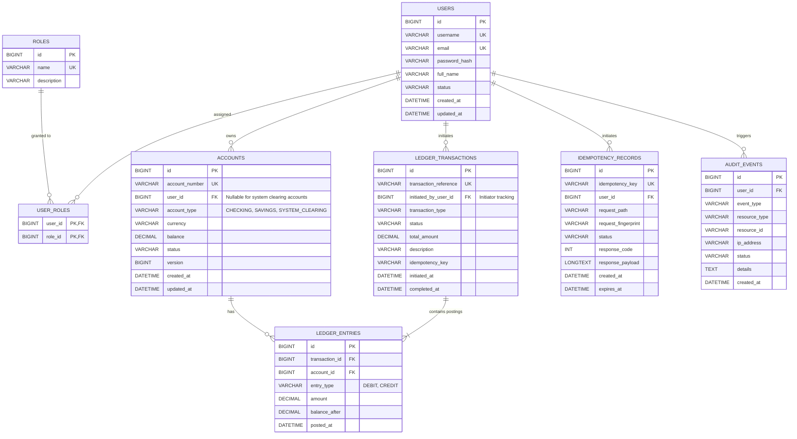

# LedgerLine — Relational Database Design Specification
**Date:** 2026-11-09
**Status:** Implemented & Verified Baseline (Day 4)
**Target Engine:** MySQL 8.0 (InnoDB Storage Engine)

---

## 1. Core Financial Data Principles

The LedgerLine database schema is designed according to standard double-entry bookkeeping and high-integrity financial systems:

1. **Monetary Precision:** All balance and monetary values are strictly stored as `DECIMAL(19, 2)`. The usage of `FLOAT`, `DOUBLE`, or any imprecise floating-point representation is strictly prohibited.
2. **Double-Entry Balance Equation:** In every financial event:
   $$\sum \text{Debits} = \sum \text{Credits}$$
   - An internal transfer creates one `ledger_transactions` record and exactly two `ledger_entries` records:
     - 1 `DEBIT` entry against the sender account.
     - 1 `CREDIT` entry against the receiver account.
     - Sum of debit amounts equals sum of credit amounts.
   - External deposits and withdrawals also create balanced double-entry postings via a designated `SYSTEM_CLEARING` account.
3. **No-Overdraft Rule for Customer Accounts:** Customer accounts (`CHECKING`, `SAVINGS`) must never fall below zero. Enforced via database-level `CHECK (account_type = 'SYSTEM_CLEARING' OR balance >= 0.00)` constraints in addition to application-level locks.
4. **Append-Only Ledger:** Ledger tables (`ledger_transactions`, `ledger_entries`) are strictly append-only. No `UPDATE` or `DELETE` statements are ever executed against posted ledger records.
5. **Initiator Tracking:** Every `ledger_transactions` record captures `initiated_by_user_id` to maintain an immutable link to the authenticated actor who requested the money movement.
6. **Reconciliation Proof:** An account's current `balance` column serves as an optimized materialized balance. At any moment, it must strictly equal:
   $$\text{Current Balance} = \sum \text{Credit Entries} - \sum \text{Debit Entries}$$
   Auditor tools reconcile this mathematical truth continuously.

---

## 2. Entity-Relationship (ER) Diagram



---

## 3. Detailed Table Specifications

### 3.1 Table: `users`
Represents application actors (Account Holders, Administrators, Auditors, and System Actors).

| Column | Data Type | Modifiers | Description |
| :--- | :--- | :--- | :--- |
| `id` | `BIGINT` | `AUTO_INCREMENT`, `PRIMARY KEY` | Unique synthetic identifier. |
| `username` | `VARCHAR(50)` | `NOT NULL`, `UNIQUE` | Unique login handle. |
| `email` | `VARCHAR(100)` | `NOT NULL`, `UNIQUE` | Primary email address. |
| `password_hash` | `VARCHAR(255)` | `NOT NULL` | BCrypt/Argon2 one-way salted password hash. |
| `full_name` | `VARCHAR(100)` | `NOT NULL` | Legal or display name of the user. |
| `status` | `VARCHAR(20)` | `NOT NULL`, `DEFAULT 'ACTIVE'` | Status: `ACTIVE`, `SUSPENDED`, `LOCKED`. |
| `created_at` | `DATETIME(6)` | `NOT NULL`, `DEFAULT CURRENT_TIMESTAMP(6)` | Creation audit timestamp. |
| `updated_at` | `DATETIME(6)` | `NOT NULL`, `DEFAULT CURRENT_TIMESTAMP(6) ON UPDATE CURRENT_TIMESTAMP(6)` | Last modified timestamp. |

- **Indexes:**
  - `idx_users_username` (`username`) — Unique
  - `idx_users_email` (`email`) — Unique

---

### 3.2 Table: `roles`
Stores authorization roles in the system.

| Column | Data Type | Modifiers | Description |
| :--- | :--- | :--- | :--- |
| `id` | `BIGINT` | `AUTO_INCREMENT`, `PRIMARY KEY` | Unique role identifier. |
| `name` | `VARCHAR(50)` | `NOT NULL`, `UNIQUE` | Role name (`ROLE_USER`, `ROLE_ADMIN`, `ROLE_AUDITOR`). |
| `description` | `VARCHAR(255)` | `NULL` | Human-readable role description. |

---

### 3.3 Table: `user_roles`
Junction table linking users to their assigned roles (Many-to-Many).

| Column | Data Type | Modifiers | Description |
| :--- | :--- | :--- | :--- |
| `user_id` | `BIGINT` | `NOT NULL`, `FK -> users(id)` | User reference. |
| `role_id` | `BIGINT` | `NOT NULL`, `FK -> roles(id)` | Role reference. |

- **Primary Key:** `(user_id, role_id)`

---

### 3.4 Table: `accounts`
Holds customer balance accounts and system clearing accounts.

| Column | Data Type | Modifiers | Description |
| :--- | :--- | :--- | :--- |
| `id` | `BIGINT` | `AUTO_INCREMENT`, `PRIMARY KEY` | Synthetic account identifier. |
| `account_number` | `VARCHAR(34)` | `NOT NULL`, `UNIQUE` | Public IBAN or standard account number format. |
| `user_id` | `BIGINT` | `NULL`, `FK -> users(id)` | Account owner (NULL for system clearing accounts). |
| `account_type` | `VARCHAR(20)` | `NOT NULL` | `CHECKING`, `SAVINGS`, `SYSTEM_CLEARING`. |
| `currency` | `CHAR(3)` | `NOT NULL`, `DEFAULT 'USD'` | ISO 4217 currency code. |
| `balance` | `DECIMAL(19, 2)` | `NOT NULL`, `DEFAULT 0.00` | Current balance. |
| `status` | `VARCHAR(20)` | `NOT NULL`, `DEFAULT 'ACTIVE'` | Status: `ACTIVE`, `FROZEN`, `CLOSED`. |
| `version` | `BIGINT` | `NOT NULL`, `DEFAULT 0` | Optimistic lock version counter. |
| `created_at` | `DATETIME(6)` | `NOT NULL`, `DEFAULT CURRENT_TIMESTAMP(6)` | Account creation timestamp. |
| `updated_at` | `DATETIME(6)` | `NOT NULL`, `DEFAULT CURRENT_TIMESTAMP(6) ON UPDATE CURRENT_TIMESTAMP(6)` | Balance update timestamp. |

- **Constraints:**
  - `chk_accounts_balance_positive`: `CHECK (account_type = 'SYSTEM_CLEARING' OR balance >= 0.00)`
    *(Customer accounts can never be overdrawn. The SYSTEM_CLEARING account serves as the double-entry counterparty for external inflows and outflows).*
- **Indexes:**
  - `idx_accounts_acc_num` (`account_number`) — Unique
  - `idx_accounts_user_id` (`user_id`)
  - `idx_accounts_type` (`account_type`)
  - `idx_accounts_status` (`status`)

---

### 3.5 Table: `ledger_transactions`
The header record grouping atomic double-entry postings for a single business event.

| Column | Data Type | Modifiers | Description |
| :--- | :--- | :--- | :--- |
| `id` | `BIGINT` | `AUTO_INCREMENT`, `PRIMARY KEY` | Synthetic transaction journal ID. |
| `transaction_reference` | `VARCHAR(64)` | `NOT NULL`, `UNIQUE` | Public unique UUID tracking reference. |
| `initiated_by_user_id` | `BIGINT` | `NOT NULL`, `FK -> users(id)` | **Initiator tracking:** User who submitted the request. |
| `transaction_type` | `VARCHAR(30)` | `NOT NULL` | `TRANSFER`, `DEPOSIT`, `WITHDRAWAL`, `ADJUSTMENT`. |
| `status` | `VARCHAR(20)` | `NOT NULL` | `PENDING`, `COMPLETED`, `FAILED`, `REVERSED`. |
| `total_amount` | `DECIMAL(19, 2)` | `NOT NULL` | Total transfer amount (`> 0.00`). |
| `description` | `VARCHAR(255)` | `NULL` | Transaction narrative / memo. |
| `idempotency_key` | `VARCHAR(64)` | `NULL`, `INDEX` | Associated client idempotency key. |
| `initiated_at` | `DATETIME(6)` | `NOT NULL` | Start timestamp. |
| `completed_at` | `DATETIME(6)` | `NULL` | Completion / commit timestamp. |

- **Constraints:**
  - `chk_ledger_tx_amount`: `CHECK (total_amount > 0.00)`
- **Indexes:**
  - `idx_ledger_tx_ref` (`transaction_reference`) — Unique
  - `idx_ledger_tx_initiator` (`initiated_by_user_id`)
  - `idx_ledger_tx_idemp` (`idempotency_key`)
  - `idx_ledger_tx_created` (`initiated_at`)

---

### 3.6 Table: `ledger_entries`
The atomic double-entry postings. Each financial transaction creates balanced postings here.

| Column | Data Type | Modifiers | Description |
| :--- | :--- | :--- | :--- |
| `id` | `BIGINT` | `AUTO_INCREMENT`, `PRIMARY KEY` | Synthetic ledger posting ID. |
| `transaction_id` | `BIGINT` | `NOT NULL`, `FK -> ledger_transactions(id)` | Parent transaction journal ID. |
| `account_id` | `BIGINT` | `NOT NULL`, `FK -> accounts(id)` | Target account affected. |
| `entry_type` | `VARCHAR(10)` | `NOT NULL` | `DEBIT` or `CREDIT`. |
| `amount` | `DECIMAL(19, 2)` | `NOT NULL` | Positive amount (`> 0.00`). |
| `balance_after` | `DECIMAL(19, 2)` | `NOT NULL` | Account balance immediately after posting. |
| `posted_at` | `DATETIME(6)` | `NOT NULL`, `DEFAULT CURRENT_TIMESTAMP(6)` | Append timestamp. |

- **Constraints:**
  - `chk_ledger_entries_amount`: `CHECK (amount > 0.00)`
  - `chk_ledger_entry_type`: `CHECK (entry_type IN ('DEBIT', 'CREDIT'))`
- **Foreign Keys:**
  - `fk_entries_tx` -> `ledger_transactions(id)` ON DELETE RESTRICT
  - `fk_entries_account` -> `accounts(id)` ON DELETE RESTRICT
- **Indexes:**
  - `idx_entries_account_posted` (`account_id`, `posted_at`) — Optimized for account statements
  - `idx_entries_tx_id` (`transaction_id`)

---

### 3.7 Table: `idempotency_records`
Stores client idempotency keys, canonical SHA-256 request hashes, execution status, and serialized responses. Governed by database unique constraint `uk_idemp_user_op_key` on `(user_id, operation_type, idempotency_key)` to serialize concurrent requests and eliminate duplicate executions.

| Column | Data Type | Modifiers | Description |
| :--- | :--- | :--- | :--- |
| `id` | `BIGINT` | `AUTO_INCREMENT`, `PRIMARY KEY` | Synthetic ID. |
| `idempotency_key` | `VARCHAR(64)` | `NOT NULL` | Client-provided key (max 64 chars). |
| `user_id` | `BIGINT` | `NOT NULL`, `FK -> users(id)` | Initiating authenticated user. |
| `operation_type` | `VARCHAR(30)` | `NOT NULL`, `DEFAULT 'TRANSFER'` | Financial operation domain (`TRANSFER`). |
| `request_path` | `VARCHAR(255)` | `NOT NULL` | HTTP API URI path (`/api/v1/transfers`). |
| `request_hash` | `CHAR(64)` | `NOT NULL` | SHA-256 hex digest of normalized canonical payload. |
| `transaction_reference` | `VARCHAR(64)` | `NULL` | Associated `ledger_transactions.transaction_reference`. |
| `status` | `VARCHAR(20)` | `NOT NULL`, `DEFAULT 'COMPLETED'` | Record state: `COMPLETED`. |
| `response_code` | `INT` | `NULL` | HTTP response status code (e.g., 201). |
| `response_payload` | `LONGTEXT` | `NULL` | Serialized JSON response to replay without re-executing. |
| `created_at` | `DATETIME(6)` | `NOT NULL`, `DEFAULT CURRENT_TIMESTAMP(6)` | Initial request arrival timestamp. |
| `updated_at` | `DATETIME(6)` | `NOT NULL`, `DEFAULT CURRENT_TIMESTAMP(6)` | Record update timestamp. |

- **Constraints:**
  - `uk_idemp_user_op_key`: `UNIQUE (user_id, operation_type, idempotency_key)`
  - `fk_idemp_user`: `FOREIGN KEY (user_id) REFERENCES users(id) ON DELETE RESTRICT`
- **Indexes:**
  - `idx_idemp_key` (`idempotency_key`)
  - `idx_idemp_user_id` (`user_id`)
  - `idx_idemp_created` (`created_at`)

---

### 3.8 Table: `audit_events`
Immutable record of security events, administrative actions, and refused/rejected transactions. To prevent operational lock contention or cascade failures during error rollbacks, this table functions as an autonomous append-only audit sink decoupled from foreign key constraints.

| Column | Data Type | Modifiers | Description |
| :--- | :--- | :--- | :--- |
| `id` | `BIGINT` | `AUTO_INCREMENT`, `PRIMARY KEY` | Synthetic event ID. |
| `event_type` | `VARCHAR(50)` | `NOT NULL` | e.g., `WITHDRAWAL_REFUSED_INSUFFICIENT_FUNDS`, `DEPOSIT_COMPLETED`, `RECONCILIATION_DISCREPANCY`. |
| `user_id` | `BIGINT` | `NULL` | Acting user ID, or NULL if unauthenticated. |
| `account_id` | `BIGINT` | `NULL` | ID of the affected account. |
| `details` | `VARCHAR(1000)` | `NULL` | Diagnostic narrative of the event. |
| `ip_address` | `VARCHAR(45)` | `NULL` | IPv4 or IPv6 client origin. |
| `created_at` | `DATETIME(6)` | `NOT NULL`, `DEFAULT CURRENT_TIMESTAMP(6)` | Event generation timestamp. |

- **Indexes:**
  - `idx_audit_event_type` (`event_type`)
  - `idx_audit_user_id` (`user_id`)
  - `idx_audit_account_id` (`account_id`)
  - `idx_audit_created` (`created_at`)

---

## 4. Ledger Representation of Financial Operations

### 4.1 Internal Transfer (Customer Alice -> Customer Bob)
Suppose Alice transfers \$100.00 to Bob:
1. One row inserted into `ledger_transactions`:
   - `transaction_reference`: `TX-XFER-10023`
   - `initiated_by_user_id`: `Alice.id`
   - `transaction_type`: `TRANSFER`
   - `total_amount`: `100.00`
   - `status`: `COMPLETED`
2. Two rows inserted into `ledger_entries`:
   - Entry 1: `account_id = Alice.accountId`, `entry_type = DEBIT`, `amount = 100.00`, `balance_after = Alice.balance - 100.00`
   - Entry 2: `account_id = Bob.accountId`, `entry_type = CREDIT`, `amount = 100.00`, `balance_after = Bob.balance + 100.00`
3. Resulting invariant:
   $$\text{Debit Amount (100.00)} = \text{Credit Amount (100.00)}$$
   Net money across internal accounts is strictly conserved ($\Delta = \$0.00$).

### 4.2 External Deposit (External Funding -> Customer Alice)
In true double-entry bookkeeping, funds do not magically appear from void; they originate from a designated System External Clearing Account (`account_type = 'SYSTEM_CLEARING'`):
1. Alice deposits \$500.00 from an external bank card/transfer.
2. One row inserted into `ledger_transactions`:
   - `transaction_reference`: `TX-DEP-50012`
   - `initiated_by_user_id`: `Alice.id`
   - `transaction_type`: `DEPOSIT`
   - `total_amount`: `500.00`
   - `status`: `COMPLETED`
3. Two rows inserted into `ledger_entries`:
   - Entry 1: `account_id = SYSTEM_CLEARING_ID`, `entry_type = DEBIT`, `amount = 500.00`, `balance_after = Clearing.balance - 500.00`
   - Entry 2: `account_id = Alice.accountId`, `entry_type = CREDIT`, `amount = 500.00`, `balance_after = Alice.balance + 500.00`
4. Resulting invariant:
   $$\text{Debit (Clearing: 500.00)} = \text{Credit (Alice: 500.00)}$$
   Every deposit is 100% double-entry balanced. The clearing account tracks total net external capital absorbed.

### 4.3 External Withdrawal (Customer Alice -> External Cash Out)
1. Alice withdraws \$150.00 to an external destination.
2. One row inserted into `ledger_transactions`:
   - `transaction_reference`: `TX-WTH-15099`
   - `initiated_by_user_id`: `Alice.id`
   - `transaction_type`: `WITHDRAWAL`
   - `total_amount`: `150.00`
   - `status`: `COMPLETED`
3. Two rows inserted into `ledger_entries`:
   - Entry 1: `account_id = Alice.accountId`, `entry_type = DEBIT`, `amount = 150.00`, `balance_after = Alice.balance - 150.00`
   - Entry 2: `account_id = SYSTEM_CLEARING_ID`, `entry_type = CREDIT`, `amount = 150.00`, `balance_after = Clearing.balance + 150.00`
4. Resulting invariant:
   $$\text{Debit (Alice: 150.00)} = \text{Credit (Clearing: 150.00)}$$
   Alice's balance decreases by \$150.00 (verified `balance >= 0.00`), while the Clearing account credits \$150.00 to record the cash outflow.

---

## 5. Mathematical Proof of Reconciliation

For any customer account $A$, the balance at time $T$ must mathematically satisfy:

$$\text{ReconciledBalance}(A, T) = \sum_{e \in \text{Entries}(A), e.posted\_at \le T} \Big( [e.type = \text{CREDIT}] \times e.amount - [e.type = \text{DEBIT}] \times e.amount \Big)$$

SQL verification query executed by the Auditor engine:
```sql
SELECT
    a.id AS account_id,
    a.account_number,
    a.account_type,
    a.balance AS current_balance,
    COALESCE(SUM(CASE WHEN e.entry_type = 'CREDIT' THEN e.amount ELSE -e.amount END), 0.00) AS computed_balance,
    (a.balance - COALESCE(SUM(CASE WHEN e.entry_type = 'CREDIT' THEN e.amount ELSE -e.amount END), 0.00)) AS discrepancy
FROM accounts a
LEFT JOIN ledger_entries e ON a.id = e.account_id
WHERE a.id = :targetAccountId
GROUP BY a.id, a.account_number, a.account_type, a.balance;
```

A healthy account will always yield `discrepancy = 0.00`. If `discrepancy != 0.00`, an immediate reconciliation alert is fired.
