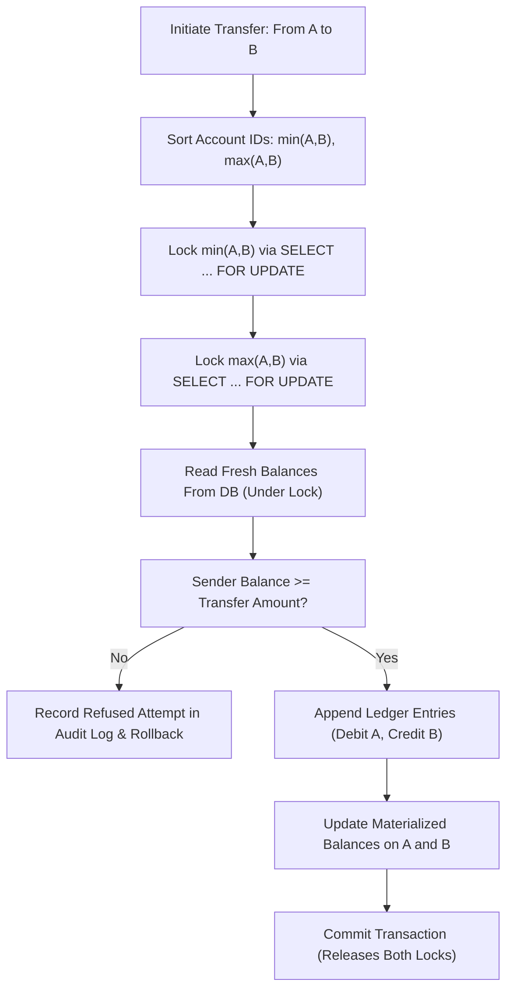

# LedgerLine — Financial Integrity & Concurrency Architecture
**Date:** 2026-11-06
**Status:** Approved Design Baseline (Day 1)
**System:** LedgerLine — Money Movement With a Ledger You Can Prove

---

## 1. Executive Overview

In financial computing, simple balance increments (`UPDATE accounts SET balance = balance + ?`) are fundamentally flawed under concurrent load, network retries, and distributed network partitions. LedgerLine guarantees financial soundness through a multi-tier defense architecture combining **atomic database transactions, deterministic pessimistic row locking, client-driven idempotency keys, cryptographically fingerprinted payloads, append-only double-entry journaling, and continuous balance reconciliation**.

---

## 2. Integrity Pillars & Implementation Strategies

### 2.1 Atomic Database Transactions
- **Mechanism:** Every money movement operation is encapsulated within a strict Spring `@Transactional(isolation = Isolation.READ_COMMITTED, rollbackFor = Exception.class)` boundary.
- **Guarantee:** If any step fails (e.g. database disconnect, balance validation error, constraint violation), the entire database transaction is rolled back by the InnoDB engine. No partial states—such as a debit without a corresponding credit—can ever persist to disk.

### 2.2 Account Row Locking & Deterministic Lock Ordering
- **The Problem:** In concurrent bidirectional transfers between two accounts:
  - Thread 1: Account 1 -> Account 2
  - Thread 2: Account 2 -> Account 1
  If Thread 1 locks Account 1 first while Thread 2 locks Account 2 first, a classic database deadlock (`Deadlock found when trying to get lock; try restarting transaction`) occurs.
- **The LedgerLine Solution:**
  1. Both account IDs are evaluated prior to locking.
  2. Locks are acquired in strictly ascending order of primary key:
     $$\text{First Lock} = \min(\text{accountId}_A, \text{accountId}_B)$$
     $$\text{Second Lock} = \max(\text{accountId}_A, \text{accountId}_B)$$
  3. The service executes pessimistic write queries (`SELECT ... FOR UPDATE` via `LockModeType.PESSIMISTIC_WRITE`).
  4. Because all concurrent threads request account locks in the exact same order, circular wait conditions are mathematically impossible. Deadlocks are completely eliminated.

### 2.3 Balance Validation After Locking (Fresh Read Principle)
- A critical flaw in naive systems is checking the account balance before acquiring the lock or relying on a cached entity in memory.
- Under LedgerLine's protocol, balance validation occurs **exclusively after** the pessimistic write lock has been granted on the account row (`SELECT ... FOR UPDATE` via `accountRepository.findByIdWithLock(accountId)`).
- **Hibernate Session Cache Isolation:** The entity must not be loaded via an unlocked `findById()` prior to locking, as Hibernate's First-Level Session Cache would cache stale pre-lock balance fields. By acquiring `findByIdWithLock(accountId)` as the initial query in the transaction, Hibernate hydrates the entity directly from the newly locked, authoritatively committed database row.
- In `ConcurrentWithdrawalTest`, two concurrent ₹400 withdrawals against a ₹500 balance run simultaneously. Thread 1 acquires the lock, checks balance, and deducts ₹400 (balance becomes ₹100). Thread 2 waits on the row lock; upon acquiring it, it reads the fresh balance (₹100), detects insufficient funds for ₹400, logs an audit event, and throws `InsufficientFundsException` (HTTP 422). Overdrafts are mathematically and physically impossible.

### 2.4 Autonomous Audit Logging (REQUIRES_NEW)
- When a financial transaction fails (e.g., insufficient funds during an attempted withdrawal), the primary financial transaction must roll back cleanly to ensure zero balance modification and zero partial ledger entries.
- However, financial regulations mandate that refused transactions and security violations must be permanently logged in `audit_events`.
- LedgerLine implements `AuditService.recordEvent()` with `@Transactional(propagation = Propagation.REQUIRES_NEW)`.
- When invoked, the audit event is committed in an autonomous database transaction decoupled from the operational transaction. Even when the outer financial transaction rolls back, the audit record remains permanently persisted on disk.
- To prevent self-deadlocks between the primary transaction and the autonomous audit transaction, `audit_events` is decoupled from foreign key constraints on mutable business tables.

### 2.4 Idempotency Keys & Request Fingerprints
- **Idempotency-Key Header:** Every non-idempotent HTTP request (`POST /api/v1/transfers`, `POST /api/v1/accounts/{id}/withdrawals`, etc.) must include an `Idempotency-Key` header with a client-generated UUIDv4.
- **Request Fingerprinting:** To prevent malicious attackers or buggy clients from replaying an existing key with different parameters (e.g. key `abc` used for \$10, then reused for \$10,000), LedgerLine generates a SHA-256 fingerprint:
  $$\text{Fingerprint} = \text{SHA256}(\text{UserId} + \text{HTTP Method} + \text{Path} + \text{Normalized JSON Payload})$$
- **State Machine in `idempotency_records`:**
  1. `IN_PROGRESS`: The request is currently being processed by an active thread. A duplicate incoming request with the same key returns `409 Conflict` (Operation in progress, retry shortly).
  2. `SUCCESS`: The transaction completed. The stored response payload and status code (e.g. `201 Created`) are returned immediately without re-executing any business or ledger logic.
  3. `FAILED`: The transaction was rejected (e.g., insufficient funds). The cached failure response is returned.
- If a client supplies an existing `Idempotency-Key` whose stored fingerprint does not match the incoming request's fingerprint, the server rejects the call with `400 Bad Request (Idempotency key payload mismatch)`.

### 2.5 Defense-in-Depth Overdraft Prevention
Even if an application thread suffered an unexpected bug, an account can never become overdrawn due to three distinct defense barriers:
1. **Application Pre-Lock Validation:** DTO checks ensure `amount > 0`.
2. **Pessimistic In-Transaction Check:** `if (sourceAccount.getBalance().compareTo(amount) < 0) throw new InsufficientFundsException()`.
3. **Relational Database Constraint:** `ALTER TABLE accounts ADD CONSTRAINT chk_accounts_balance_positive CHECK (balance >= 0.00)`. If an errant update attempts to push a balance below 0.00, MySQL rejects the write at the storage engine layer.

### 2.6 Append-Only Double-Entry Ledger Principles
- Financial truth is recorded in `ledger_transactions` and `ledger_entries`.
- No application controller, service, or repository method provides `UPDATE` or `DELETE` capabilities on ledger records.
- If an erroneous transaction must be reversed, it is never deleted or altered. Instead, a new `REVERSAL` transaction is appended with inverse double-entry postings, preserving a permanent audit trail.

### 2.7 Refused Transaction Auditing
- When a transaction is rejected due to insufficient balance, invalid account state, or velocity limits, the failure is treated as a security and audit event.
- A non-reverting audit record is written to `audit_events` with:
  - `event_type`: `TRANSFER_REFUSED_INSUFFICIENT_FUNDS`
  - `user_id`: Initiator ID
  - `resource_id`: Target Account Number
  - `details`: Requested amount, available balance at moment of attempt, timestamp, client IP.
- This provides provable records for regulatory compliance, fraud detection, and customer dispute resolution.

### 2.8 Continuous Balance Reconciliation Engine
- To prove financial consistency, LedgerLine includes a mathematical reconciliation engine.
- For any account, the materialized balance must match the ledger integral:
  $$\text{Materialized Balance} = \sum \text{Credits} - \sum \text{Debits}$$
- An auditor endpoint and automated scheduled job scan accounts and verify:
  $$\Delta = \text{account.balance} - \left( \sum_{e \in \text{entries}} e.\text{amount} \times \text{sign}(e.\text{type}) \right) = 0.00$$
- If $\Delta \ne 0.00$, the system flags a reconciliation discrepancy event.

---

## 3. How LedgerLine Prevents the Five Critical Financial Threats

### Threat 1: Duplicate Transfers (Network Retries & Double Clicks)
- **Scenario:** A user clicks "Transfer \$500" twice in rapid succession, or an intermittent network timeout causes an automated client retry after the server already processed the transfer.
- **Prevention:** The client generates a unique `Idempotency-Key` before initiating the call. The server's `IdempotencyInterceptor` looks up the key in `idempotency_records` using unique constraints. If the record exists and status is `SUCCESS`, the server replays the original `201 Created` response. No secondary debit or credit is executed.

### Threat 2: Concurrent Overdrafts (Race Conditions)
- **Scenario:** An account has a balance of \$100.00. Two concurrent requests arrive simultaneously, each requesting a \$100.00 withdrawal or transfer.
- **Prevention:** Both requests attempt to lock the account. Request 1 acquires the `SELECT ... FOR UPDATE` row lock. Request 2 is blocked and enters a wait queue. Request 1 reads balance (\$100.00), verifies funds, deducts \$100.00 (balance becomes \$0.00), posts ledger entries, and commits. Now Request 2 is granted the lock. Request 2 reads the refreshed balance directly from the locked row, observes \$0.00, rejects the transfer, and emits an `INSUFFICIENT_FUNDS` audit event. Even if application locking failed, the DB check constraint `CHECK (balance >= 0.00)` aborts the write.

### Threat 3: Partial Debit and Credit Writes
- **Scenario:** The server debits Account A, but crashes or encounters a network partition before crediting Account B.
- **Prevention:** Both debit and credit postings, along with account balance mutations, are executed inside a single ACID `@Transactional` boundary. In relational database transactions, either all writes commit together, or the transaction manager rolls back all writes upon failure. No intermediate single-sided state can ever be made visible to other queries or committed to disk.

### Threat 4: Unauthorized Transfers (Broken Object Level Authorization / IDOR)
- **Scenario:** User A crafts an API request specifying User B's account ID as the source of a transfer.
- **Prevention:** Before acquiring locks or modifying state, the `TransferService` inspects the authenticated user principal from the `SecurityContext`. It executes an ownership verification query:
  `accountRepository.findByIdAndUserId(sourceAccountId, authenticatedUserId)`
  If the account does not belong to the caller (and the caller does not hold `ROLE_ADMIN`), the request is immediately rejected with `403 Forbidden` and logged in `audit_events` as an unauthorized transfer attempt.

### Threat 5: Ledger Modification Through Normal Application APIs
- **Scenario:** A malicious insider or compromised API endpoint attempts to mutate past ledger entries to conceal embezzlement.
- **Prevention:** The Spring Data JPA `LedgerEntryRepository` and `LedgerTransactionRepository` expose only `save()` for inserts and read-only query methods (`findById`, `findByAccountId`). No `delete()`, `deleteById()`, or update queries exist in the codebase. Furthermore, at the database user permission level, the operational DB user account is granted `SELECT`, `INSERT`, `UPDATE` (on accounts only), while `DELETE` and `UPDATE` on `ledger_entries` and `ledger_transactions` are revoked.

---

## 4. Honest Scope: Realistic Security & Tamper-Evident Posture

LedgerLine explicitly distinguishes between **application-layer integrity** and **physical/infrastructure-level guarantees**:

> [!NOTE]
> **No Claim of Absolute Tamper-Proof Protection:**
> LedgerLine guarantees provable integrity against all application-level attacks, race conditions, unauthorized API calls, and network failures. However, no software-only relational architecture can claim "absolute tamper-proof protection" against an adversary with root administrative access to the underlying MySQL database server or raw disk files.
>
> To mitigate database administrator tampering:
> 1. Cryptographic hashing of ledger entries can form a hash chain ($H_n = \text{SHA256}(H_{n-1} + \text{Entry}_n)$) to make retroactive modifications cryptographically detectable by auditors.
> 2. Database binary logs and audit trails should be mirrored to an immutable external append-only storage tier (such as AWS S3 with Object Lock / WORM compliance).
