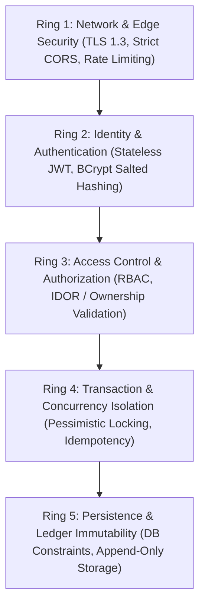

# LedgerLine — Security Architecture & Design Specification
**Date:** 2026-11-09
**Status:** Implementation Baseline (Day 4 Complete)
**System:** LedgerLine — Money Movement With a Ledger You Can Prove

---

## 1. Security Philosophy & Defense-in-Depth

Financial applications demand a defense-in-depth security model where the failure of any single protective barrier does not lead to monetary loss or data breach. LedgerLine implements controls across five distinct architectural rings:



---

## 2. Authentication Architecture

### 2.1 Password Storage & Security
- **Algorithm:** `BCryptPasswordEncoder` with a cost factor (strength) of 12.
- **Salting:** Cryptographically secure random 128-bit salt auto-generated per password by BCrypt, preventing rainbow table attacks.
- **Password Policy:**
  - Minimum length: 8 characters; Maximum length: 128 characters.
  - Required character classes: at least one uppercase letter, one lowercase letter, one numeric digit, and one special symbol (`[!@#$%^&*()_+\-=\[\]{};':"\\|,.<>\/?]`).
  - Validation enforced both client-side and server-side via `@Pattern` on registration DTOs.

### 2.2 Stateless Token Architecture (JWT)
- **Token Format:** JSON Web Token (JWT) signed with HMAC-SHA256 (`HS256`).
- **Cryptographic Key Material:**
  - Mandates at least 32 bytes (256 bits) of entropy.
  - No insecure SHA-256 fallback expansion for short keys: secrets with < 32 bytes fail fast at application startup with an `IllegalArgumentException`.
  - Secure generation: `openssl rand -hex 32` or `openssl rand -base64 32`.
- **Token Claims:**
  - `sub`: User ID or Username
  - `userId`: Numeric identifier of the user principal
  - `roles`: Assigned authorities array (e.g. `["ROLE_ACCOUNT_HOLDER"]`)
  - `iat`: Issued-at timestamp
  - `exp`: Expiration timestamp (default: 24 hours)
  - `iss`: `ledgerline-api`
- **Transmission:** Clients transmit the token via standard HTTP header:
  `Authorization: Bearer <token>`
- **Validation Pipeline:**
  The `JwtAuthenticationFilter` intercepts incoming requests, validates the signature and timestamp, reconstructs `UserDetails`, and populates the `SecurityContextHolder`.

---

## 3. Role-Based Access Control (RBAC) & Object Authorization

### 3.1 Role Hierarchy & Permissions

| Role | Domain Scope | Permissions |
| :--- | :--- | :--- |
| **`ROLE_USER`** | Personal customer accounts | Register, authenticate, create accounts, deposit funds, withdraw funds, execute internal transfers between owned or target accounts, view personal statements. **Cannot** access administrative or auditor tools. |
| **`ROLE_ADMIN`** | System platform operations | View all users, inspect account statuses, freeze/unfreeze accounts for compliance/fraud investigations. **Cannot** execute arbitrary financial debits without double-entry clearing. |
| **`ROLE_AUDITOR`** | Regulatory compliance & verification | Read-only inspection of all ledger transactions, entries, balance reconciliation queries, and security audit logs. **Cannot** initiate money movements or alter system state. |

### 3.2 Broken Object Level Authorization (BOLA / IDOR) Defense
- It is insufficient to merely verify that a user possesses `ROLE_USER`; the application must verify **resource ownership**.
- For every account operation (`/api/v1/accounts/{id}/*`), the service layer executes:
  ```java
  Account account = accountRepository.findById(accountId)
      .orElseThrow(() -> new AccountNotFoundException(accountId));

  if (!account.getUserId().equals(currentUser.getId()) && !hasRole("ROLE_ADMIN") && !hasRole("ROLE_AUDITOR")) {
      auditService.recordSecurityViolation("UNAUTHORIZED_ACCOUNT_ACCESS", currentUser.getId(), accountId);
      throw new AccessDeniedException("Access denied: You do not own this account.");
  }
  ```

### 3.3 Transfer Authorization & Separation of Duties
- **Source Account Ownership:** In `TransferServiceImpl.transfer()`, the system strictly validates that `sourceAccount.isOwnedBy(currentUser.getId())`. An account holder cannot initiate transfers or debit funds from accounts owned by other users.
- **Auditor Restriction:** Users possessing `ROLE_AUDITOR` are strictly forbidden from initiating financial transfers (`AccessDeniedException`). Auditor permissions are exclusively read-only for compliance, inspection, and mathematical reconciliation.
- **Clearing Account Immunity:** Customers cannot transfer funds to or from system clearing accounts (`SYSTEM_CLEARING`).
- **Privacy Preservation:** Cross-account transfer failures (e.g. invalid destination state) never disclose private balances, identities, or details of other users' accounts.

---

## 4. Input Validation & Data Sanitization

- **No Implicit Trust:** All incoming request payloads are strictly validated before hitting business logic using Jakarta Bean Validation (`@Valid`).
- **Monetary Validation:**
  - `@NotNull(message = "Amount is required")`
  - `@DecimalMin(value = "0.01", inclusive = true, message = "Amount must be strictly positive")`
  - `@Digits(integer = 15, fraction = 2, message = "Amount must have at most 2 decimal places")`
- **String Sanitization:** Text inputs (memos, full names, usernames) are validated against strict character whitelists to eliminate XSS and injection vectors.

---

## 5. Error Handling & Information Leakage Prevention

- In production, unhandled exceptions must never disclose database queries, ORM mapping details, internal server paths, or raw stack traces.
- Centralized exception management via `@RestControllerAdvice` translates domain exceptions into RFC 7807 Problem Detail structures:
  - Custom exceptions (`InsufficientFundsException`, `DuplicateRequestException`, `AccountFrozenException`) map to standardized HTTP status codes (`422`, `409`, `403`).
  - Unexpected runtime exceptions map to an opaque `500 Internal Server Error` with an incident reference tracking ID logged privately.

---

## 6. Audit Logging & Non-Repudiation

- High-value financial and security operations emit non-blocking, append-only records to `audit_events`:
  1. Failed login attempts (brute force detection).
  2. Privilege escalation attempts (unauthorized admin/auditor calls).
  3. Refused financial transactions (insufficient funds, frozen account).
  4. Account status changes (administrative freezing).
- Every audit entry captures:
  - `user_id`
  - `event_type`
  - `resource_id`
  - `ip_address`
  - `created_at`
  - Diagnostic metadata snapshot.

### 6.1 Dual Transaction Boundary Architecture (`REQUIRED` vs `REQUIRES_NEW`)
To prevent false audit entries while ensuring immutable security violation and refusal records:

1. **Transactionally Consistent Completion Events (`recordConsistentEvent` — `Propagation.REQUIRED`):**
   - Events recording the completion of state mutations (`TRANSFER_COMPLETED`, `DEPOSIT_COMPLETED`, `WITHDRAWAL_COMPLETED`) participate in the active transaction boundary.
   - If an unexpected error, constraint violation, or rollback occurs, the completion audit event rolls back atomically with the balance updates, ledger entries, and idempotency records, guaranteeing that no false success audit logs ever exist.

2. **Autonomous Refusal & Security Events (`recordAutonomousEvent` — `Propagation.REQUIRES_NEW`):**
   - Audit events for refused operations (e.g., `TRANSFER_REFUSED_INSUFFICIENT_FUNDS`, `WITHDRAWAL_REFUSED_INSUFFICIENT_FUNDS`, `RECONCILIATION_DISCREPANCY`) execute in an autonomous transaction (`REQUIRES_NEW`).
   - The outer transaction is temporarily suspended while the refusal log is committed. Even when the outer financial transaction subsequently rolls back due to `InsufficientFundsException`, the refusal record remains permanently persisted.
   - **Database Lock Decoupling:** In MySQL InnoDB, foreign key constraints enforce shared (`S`) locks on referenced parent rows (`accounts`). If an outer transaction holds an exclusive row lock (`X` lock via `SELECT ... FOR UPDATE`) on an account, an autonomous inner transaction attempting to insert an `audit_event` with a foreign key back to `accounts` would block waiting for the outer lock to release, causing lock wait timeouts or self-deadlocks. Consequently, `audit_events` references entity IDs (`account_id`, `user_id`) as indexed numeric fields without relational FK constraints.

---

## 7. Concurrency Control & Race Condition Immunity

### 7.1 Pessimistic Row Locking (`SELECT ... FOR UPDATE`)
- To prevent double-spending and race condition overdrafts, all mutating balance operations lock the customer account row immediately upon entering the transaction.
- `AccountRepository.findByIdWithLock(accountId)` issues `SELECT ... FOR UPDATE` under `Isolation.READ_COMMITTED`.

### 7.2 Fresh Read Principle & Session Cache Isolation
- Hibernate maintains an L1 (session) entity cache. If an entity is read using an unlocked query prior to locking, Hibernate caches that entity. Subsequent calls to lock the entity may return the cached representation without querying MySQL again.
- **Enforcement:** `TransactionServiceImpl` and `TransferServiceImpl` mandate that `findByIdWithLock(accountId)` is the **first query executed** within the transaction boundary, ensuring the latest committed row state and balance are loaded directly from the database under lock.

### 7.3 Deterministic Lock Ordering ($\min / \max$) & Deadlock Immunity
- In bidirectional transfers between accounts (e.g. Thread 1: Account 10 -> Account 20; Thread 2: Account 20 -> Account 10), opposite lock acquisition orders induce circular wait deadlocks.
- `TransferServiceImpl` computes `firstLockId = Math.min(srcId, dstId)` and `secondLockId = Math.max(srcId, dstId)`.
- Locks are always acquired in ascending account ID order:
  1. `accountRepository.findByIdWithLock(firstLockId)`
  2. `accountRepository.findByIdWithLock(secondLockId)`
- Because all threads request row locks in the identical natural order, circular wait deadlocks are mathematically eliminated. Verified under concurrent stress in `ConcurrentTransferTest.testOppositeDirectionTransfers`.

### 7.4 Database-Enforced Idempotency & Conflict Detection
- Mutating transfer operations require an `Idempotency-Key` HTTP header.
- Enforced via unique constraint `uk_idemp_user_op_key` on `(user_id, operation_type, idempotency_key)` in `idempotency_records`.
- Normalized payloads are hashed with SHA-256. Replays with identical payloads return cached responses with `replayed: true` (HTTP 200). Altered payloads on the same key are rejected with HTTP 409 Conflict.
- Failed operations (e.g. overdrafts) roll back cleanly, preventing unusable idempotency tombstones.

---

## 8. Secret Management & Version Control Hygiene

- **Rule 10 Compliance:** No plaintext secrets, tokens, or private credentials may ever be committed to source control.
- In `backend/ledgerline-api/src/main/resources/application.properties`:
  Values are externalized using Spring property placeholders:
  ```properties
  spring.datasource.url=${DB_URL:jdbc:mysql://localhost:3306/ledgerline}
  spring.datasource.username=${DB_USERNAME:ledgerline_user}
  spring.datasource.password=${DB_PASSWORD:secret_password}
  jwt.secret=${JWT_SECRET:default_dev_secret_key_at_least_256_bits_long_example}
  ```
- The root `.gitignore` excludes `.env`, `credentials/`, `secrets/`, and local keystores.
